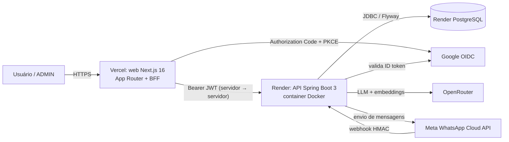
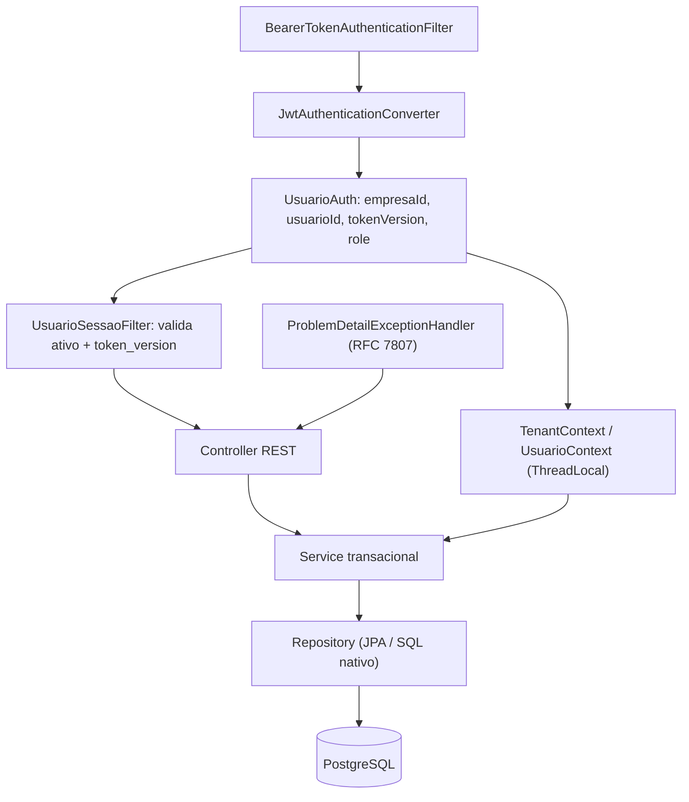
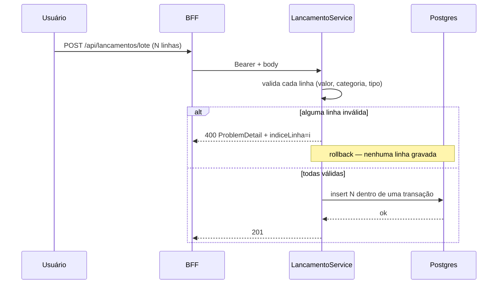
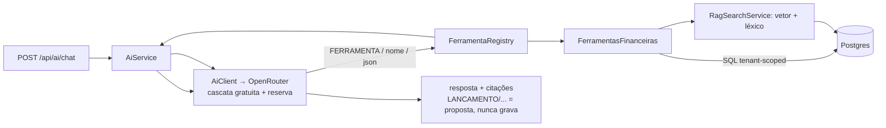
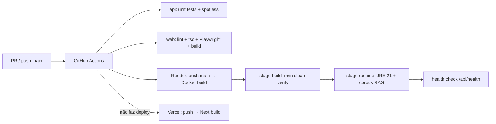

# ARCHITECTURE.md — Controle Financeiro

**Atualizado em:** 2026-11-25
**Escopo:** arquitetura ponta a ponta (browser → BFF → API → banco → integrações), com o racional das decisões.
**Convenção:** referências no formato `caminho/arquivo:linha` apontam para o estado atual do working tree. Quando uma documentação antiga diverge do código, o código prevalece — as divergências estão mapeadas na [seção 11](#11-documentação-desatualizada-e-como-ler).

---

## 1. Visão geral

### 1.1 Contexto do sistema (C4 nível 1)



| Componente | Responsabilidade | Tecnologia | Onde roda |
|---|---|---|---|
| Web | UI financeira, BFF, sessão httpOnly, OAuth server-side | Next.js 16.4.3, React 19.3, TS, Tailwind 4, Recharts | Vercel (Root Directory `web/`) |
| API | Regras de negócio, autenticação, isolamento, IA, integrações | Java 21, Spring Boot 3.5.16, Spring Security, JPA, Flyway | Render (Docker, `api/Dockerfile`) |
| Banco | Persistência transacional, RAG vetorial e busca textual | PostgreSQL + pgvector | Render PostgreSQL (Oregon) |
| Corpus RAG | Base de conhecimento financeiro em JSONL | 3.142 chunks | Embutido na imagem da API |

### 1.2 Core value e invariantes

O valor central é **saldo, entradas e saídas corretos ao centavo**, conferíveis contra SQL direto (`AGENTS.md`, `.planning/PROJECT.md:7-9`). Dessa premissa decorrem sete regras que nenhuma camada pode violar:

| # | Invariante | Onde é garantido | Por quê |
|---|---|---|---|
| R1 | `BigDecimal` com `NUMERIC(14,2)`, `scale=2`, `HALF_EVEN` | Service layer + DDL | `double`/`float` introduzem erro de arredondamento em dinheiro |
| R2 | Entrada com mais de 2 casas decimais é rejeitada | Validação de request | Evita aceitar valor que o banco arredondaria silenciosamente |
| R3 | `empresa_id` e `usuario_id` vêm **só** do JWT | `TenantContext`, `UsuarioContext`, filtros e repositórios | Impede que o client manipule o escopo de dados |
| R4 | Lote é tudo-ou-nada e o erro informa `indiceLinha` | Transação no service + `LinhaInvalidaException` | Cliente conferiu explicitamente que nenhuma linha seja gravada se uma falhar |
| R5 | Categoria `ENTRADA` não aceita `SAÍDA` e vice-versa | Service de lançamento | Integridade semântica do saldo |
| R6 | Senha com BCrypt(12), trânsito via HTTPS | `SecurityConfig.java:135-139`, Vercel/Render | Requisito de segurança do brief |
| R7 | IA nunca é fonte de números | Tools consultam SQL/repositórios | LLM arredonda e inventa; números devem vir das mesmas consultas do dashboard |

A serialização Jackson preserva esses invariantes na borda: `fail-on-unknown-properties: true`, `write-bigdecimal-as-plain: true` e timezone `America/Sao_Paulo` (`api/src/main/resources/application.yml:28-36`).

### 1.3 Trust boundaries

1. **Browser → Vercel:** cookie `sess` httpOnly; o browser nunca recebe JWT nem ID token Google.
2. **Vercel → Render**: Bearer JWT gerado pela API, trafegando apenas server-side.
3. **Render → banco**: `empresa_id`/`usuario_id` extraídos do token e aplicados em toda query financeira.
4. **Meta → Render**: webhook público autenticado por HMAC `X-Hub-Signature-256`, não por JWT.

O gate do `proxy.ts` é **UX**, não autorização; o limite real está no Spring Security (`SECURITY.md:364-369`).

---

## 2. Backend — API Spring Boot

### 2.1 Estrutura em fatias verticais

O código é organizado por domínio, não por camada global (`api/src/main/java/com/controlefinanceiro/`):

```
auth/          login, registro, Google, convites, /me
usuario/       contas da empresa, convites, papel, desativação, telefone
empresa/       raiz do tenant
categoria/     categorias e grupos 50/30/20
lancamento/    CRUD + lote
dashboard/     KPIs, gasto por categoria, comparação mensal
conta/         contas a pagar
importacao/    upload de PDF, staging, confirmação
ai/            chat, ferramentas, memória, conhecimento, RAG
whatsapp/      vínculo de telefone, código, webhook, auditoria
helpdesk/      tickets de USER e fila ADMIN
common/        Role, exceções, contextos, UsuarioAuth
config/        SecurityConfig, ProblemDetailExceptionHandler
db/migration/  migrations Java (V1_1, V2)
health/        /api/health
```

Cada fatia contém controller → service → repository → entidade/DTO. Isso mantém a regra de dinheiro perto de quem a aplica e evita um "service factory" centralizado.

### 2.2 Camadas internas



Pontos estruturais:

- **Autenticação padrão do framework**, não filtro JWT artesanal: `oauth2ResourceServer` com Nimbus e conversor explícito de claims (`SecurityConfig.java:89-93, 102-133`). Isso evita erros de `exp`, `alg` e clock skew.
- Claim obrigatório: `empresa_id`, `usuario_id`, `token_version` numéricos e `role` válido (`ADMIN|USER`); qualquer inconsistência gera `InvalidBearerTokenException` (`SecurityConfig.java:105-122`).
- `UsuarioSessaoFilter` roda **após** o Bearer filter e consulta o usuário a cada requisição, garantindo que desativação/demissão tenha efeito imediato, sem esperar os 8h do JWT (`MULT_TENANT.md:71-78`). Custo aceito: uma consulta por request.
- API **stateless**, CSRF e CORS desabilitados; headers `nosniff`, `DENY`, `strict-origin-when-cross-origin`, HSTS 2 anos (`SecurityConfig.java:41-55`). CSRF não se aplica porque o navegador usa cookie apenas no BFF.

### 2.3 Matriz de autorização

| Rota | Regra | Evidência |
|---|---|---|
| `/api/auth/login`, `/registro`, `/convites/aceitar`, `/google`, `/api/health` | público | `SecurityConfig.java:58-64` |
| `GET e POST /webhooks/whatsapp` | público, validado por HMAC | `SecurityConfig.java:65-69` |
| `GET /api/categorias` | ADMIN ou USER | `SecurityConfig.java:70-72` |
| `/api/categorias/**` (escrita) | ADMIN | `SecurityConfig.java:73-74` |
| `/api/usuarios/**` | ADMIN | `SecurityConfig.java:75-77` |
| `/api/ai/chat/conhecimento/**`, `/api/ai/rag/**` | ADMIN | `SecurityConfig.java:78-82` |
| `/api/helpdesk/**` | USER | `SecurityConfig.java:83-84` |
| `/api/admin/helpdesk/**` | ADMIN | `SecurityConfig.java:85-86` |
| demais `/api/**` | autenticado | `SecurityConfig.java:87-88` |

### 2.4 Inventário de endpoints

| Domínio | Endpoints |
|---|---|
| Lançamentos | `POST /api/lancamentos`, `POST /api/lancamentos/lote`, `PUT`, `DELETE` e `GET /api/lancamentos/{id}`, `GET /api/lancamentos` (`size` ≤ 100) |
| Dashboard | agregados de entradas, saídas, saldo, categorias e comparação mensal |
| Usuários | `GET /api/usuarios`, `POST /api/usuarios/convites`, `PATCH /api/usuarios/{id}`, `POST /api/usuarios/{id}/desativar`, `DELETE /api/usuarios/{id}` |
| Auth | `POST /api/auth/login`, `/registro`, `/google`, `/convites/aceitar`, `GET /api/auth/me` |
| Categorias | CRUD + grupos 50/30/20 |
| Importação | `POST /api/importacoes/pdf`, `GET /api/importacoes`, `GET` e `DELETE /api/importacoes/{id}`, `POST /api/importacoes/{id}/confirmar` |
| IA | `POST /api/ai/chat`, `GET` e `POST /api/ai/chat/conhecimento`, `POST /api/ai/chat/conhecimento/limpar`, `POST /api/ai/chat/sessao/{id}/limpar` |
| RAG | `POST /api/ai/rag/ingestir`, `GET /api/ai/rag/status` |
| WhatsApp | `GET` e `POST /webhooks/whatsapp`, vínculo de telefone e código de verificação |
| Helpdesk | `POST` e `GET /api/helpdesk/tickets`, `GET /{id}`, `POST /{id}/mensagens`; espelho ADMIN em `/api/admin/helpdesk/**` com `PATCH /{id}/status` |
| Saúde | `GET /api/health` (health check da Render e `SELECT 1`) |

### 2.5 Modelo de dados e evolução do schema

Entidades principais: `Empresa` (raiz do tenant), `Usuario` (`empresa_id`, `email` único global, `google_sub`, `email_verificado`, `token_version`, `senha_hash` BCrypt), `UsuarioConvite` (token armazenado como hash, single-use, expira), `Categoria`, `Lancamento`, `ContaAPagar`, `ImportacaoDocumento`/`Item`, `AiMemoriaSessao`/`Mensagem`, `RagChunk`/`RagIngestaoEstado`, `UsuarioTelefone`, `HelpdeskTicket`/`Mensagem`.

Migrations são **imutáveis** — nunca editar aplicadas; novas mudanças são versões novas. Hibernate não mexe no schema (`ddl-auto: none`, `application.yml:16-20`); Flyway varre `classpath:db/migration` **e** o pacote Java `com/controlefinanceiro/db/migration` (`application.yml:21-27`).

| Versão | Arquivo | Finalidade |
|---|---|---|
| V1 | `V1__schema.sql` | schema base com `empresa_id` em todas as tabelas |
| V1_1 | `V1_1__seed_empresa_admin.java` | empresa + usuário ADMIN seed |
| V2 | `V2__seed_categorias.java` | 12 saídas e 4 entradas, com flag `pessoal` |
| V3 | `V3__importacoes_pdf.sql` | staging de importação e confiança explícita |
| V5 | `V5__ajuste_hash_sha256.sql` | ajuste de hash de duplicidade |
| V6 | `V6__whatsapp_telefone.sql` | vínculo de telefone → usuário/empresa |
| V7 | `V7__whatsapp_auditoria.sql` | auditoria WhatsApp |
| V8 | `V8__renomeia_coluna_codigo.sql` | renomeação de coluna de código |
| V9 | `V9__multi_tenant_usuarios.sql` | `google_sub`, `email_verificado`, `token_version`, convites |
| V10 | `V10__isolamento_por_usuario.sql` | índices `(empresa_id, usuario_id, data)` e isolamento por usuário |
| V11 | `V11__rag_base_conhecimento.sql` | tabelas de chunks/vetores e estado de ingestão RAG |
| V12 | `V12__helpdesk.sql` | tickets e mensagens escopados por empresa/usuário |

**Por quê esse desenho:** a coluna `empresa_id` existiu desde a fase 1 mesmo no modo single-tenant, porque o custo de preparar o schema foi baixo e migrar depois seria caro (`.planning/PROJECT.md:37, 57-64`). O isolamento por `usuario_id` veio depois (`MULT_TENANT.md`, V10) quando o produto passou de "multiusuário em uma empresa" para "multiempresa real".

### 2.6 Dinheiro e lote

- `BigDecimal` do request ao banco; coluna `NUMERIC(14,2)`; arredondamento `HALF_EVEN` no service; nenhum `double`/`float`.
- `LinhaInvalidaException` carrega o índice da linha e o handler expõe a propriedade `indiceLinha` no `ProblemDetail` — o requisito de verificação do cliente é justamente testar uma linha inválida e confirmar rollback total.
- Integridade ENTRADA/SAÍDA validada no service, não apenas no banco.
- JSON não usa notação científica, preservando as duas casas decimais no contrato.

### 2.7 Isolamento multi-tenant

A regra é `empresa_id AND usuario_id` em **toda** consulta financeira; `ADMIN` não lê dados financeiros de outros usuários — ele só gerencia contas (`MULT_TENANT.md:9-17, 80-92`).

| Recurso | Filtro obrigatório | ADMIN |
|---|---|---|
| Lançamentos, importações, dashboard, contas a pagar | `empresa_id + usuario_id` | não vê alheios |
| Histórico/sessões de IA | `empresa_id + usuario_id + sessionId` | não vê alheios |
| Conhecimento e categorias | `empresa_id` | gerencia (não é dado financeiro) |
| Usuários | `empresa_id` | gerencia contas, sem finanças |
| WhatsApp | telefone → `empresa_id + usuario_id` | só o dono |

A única exceção controlada são os endpoints **pré-auth** (`/api/auth/registro`, `/google`, `/convites/aceitar`), que precisam criar/validar o tenant antes de existir JWT; nenhum endpoint de negócio aceita `empresa_id`/`usuario_id` em body, query ou path (`MULT_TENANT.md:61-69`).

Isso é fiscalizado por testes arquiteturais, não apenas por convenção: `ArchUnitIsolamentoTest` proíbe `empresaId/usuarioId` em `*Request`, proíbe controllers recebendo tenant por parâmetro e exige que repositórios financeiros tenham métodos com `usuarioId`; `IsolamentoUsuarioRepositoryTest` varre as queries declaradas e exige o filtro por `usuario.id` (`api/src/test/java/com/controlefinanceiro/common/`).

### 2.8 Erros e contratos

`ProblemDetailExceptionHandler` mapeia exceções para RFC 7807 com status semântico: 401 credenciais/Google token/sem autorização; 403 acesso negado; 404 entidades não encontradas; 409 conflitos (último ADMIN, convite inválido, telefone já vinculado); 400 validação, valor monetário, categoria, lote, importação e telefone; 413 upload grande; 429 cooldown de código; 503 falha de IA/Google.

A resposta de lote inclui `indiceLinha` (`0-based`). Multipart: 8 MB/arquivo e 40 MB/request na API, 4 MB no BFF (`application.yml:38-42`).

### 2.9 Estratégia de testes

- **Unitários:** `mvnw -Dspotless.check.skip=true test`; Surefire exclui `*IntegrationTest` e `*MigrationTest`, então não exigem Docker.
- **Integração:** Testcontainers + PostgreSQL 16, cada `*IntegrationTest` declara seu próprio `@Container @ServiceConnection` — débito técnico reconhecido (`AGENTS.md`).
- **Arquitetura:** ArchUnit para isolamento e cabeçalhos de segurança (`SecurityHeadersTest`).
- **Gates locais/CI:** `.\mvnw.cmd -q spotless:check` (Google Java Format, EOL UNIX via `.gitattributes`).

---

## 3. Frontend — Next.js e BFF

### 3.1 Estrutura

```
app/                       App Router: /, /login, /categorias, /lancamentos,
                           /contas-a-pagar, /importacoes, /suporte,
                           /admin/usuarios, /admin/suporte, /admin/rag,
                           /convite/[token]
app/api/**/route.ts         BFF: proxy server-side para a API (auth, me, lancamentos,
                           categorias, usuarios, importacoes, ai, helpdesk, rag,
                           contas-a-pagar)
components/                KPIs, tabelas, forms, gráficos, chat, painéis ADMIN, ui/
lib/                       api-client, bff, auth-bff, google-oauth*, session,
                           rate-limit, money/format, navegação, helpdesk, rag-admin
e2e/                       specs Playwright sem servidor
```

Stack: Next 16.4.3, React 19.3, TypeScript 5, Tailwind 4 + shadcn/radix, Recharts (gráficos), react-hook-form + zod, react-markdown (chat), Playwright (`web/package.json:12-40`).

### 3.2 Padrão BFF — por quê existe

O browser **nunca** guarda token. O login server-side grava cookie `sess` httpOnly/SameSite=lax ( Secure em produção ) com 8h; cada rota BFF lê esse cookie e encaminha `Authorization: Bearer ...` para `${API_URL}/api/...` via `encaminharParaApi` (`web/lib/bff.ts`, `web/lib/auth-bff.ts`). O Google client secret vive **somente** nas env vars server-side da Vercel; nada em `NEXT_PUBLIC_*`.

`proxy.ts` (Next 16 substituiu `middleware`) só verifica a **presença** do cookie para decidir redirecionamento para `/login`; o matcher exclui `/api`, `_next`, favicon e arquivos com ponto (`web/proxy.ts:11-35`). A validação real do JWT permanece na API.

`next.config.ts` aplica `nosniff`, `DENY`, `Referrer-Policy`, `Permissions-Policy` e HSTS com `preload` a todas as rotas (`web/next.config.ts:3-19`).

### 3.3 Fluxo Google (Authorization Code + PKCE)

```mermaid
sequenceDiagram
    participant B as Browser
    participant V as BFF Vercel
    participant G as Google
    participant A as API Render
    B->>V: GET /api/auth/google/start?intencao=LOGIN/CONVITE
    V->>V: gera state + verifier PKCE
    V->>B: 302 para Google + cookie google_oauth httpOnly (state, verifier)
    B->>G: autoriza
    G->>B: 302 /api/auth/google/callback?code&state
    B->>V: callback
    V->>V: compara state; troca code por tokens
    V->>A: POST /api/auth/google {idToken, intencao}
    A->>G: valida iss, aud, exp, email_verified
    A->>A: cria/entra no tenant ou consome convite; emite JWT próprio
    A->>V: {token}
    V->>B: cookie sess httpOnly + redirect /
```

Decisões incorporadas: `state` e PKCE em cookie httpOnly; o ID token Google nunca é sessão da API; o convite é lido do cookie `convite_oauth`, e `conviteToken` na query do start é **ignorado** (`web/app/api/auth/google/start/route.ts:31-59`, `web/e2e/google-oauth.spec.ts:149-180`). Cadastro por senha, aceite de convite e login compartilham o mesmo helper de cookie.

### 3.4 Rate limit e guard de preview

`web/lib/rate-limit.ts` expõe `verificarLimite` (retorna `{excedeu, reiniciaEm}` para `Retry-After`) e `limitarPorIp` (wrapper booleano usado nos testes); o `Map` fica em `globalThis` para sobreviver a hot reloads. É **process-local** — não compartilhado entre instâncias Vercel (dívida conhecida).

`web/lib/api-url.ts:10-24` é fail-closed: em `VERCEL_ENV=preview`, exige `API_URL_PREVIEW` e `API_URL_PRODUCAO`, compara origens e retorna `null` se preview apontar para produção ou se alguma URL for inválida.

### 3.5 Formatação e UI

Valores monetários são formatados no cliente em pt-BR (`web/lib/money.ts`, `web/lib/format.ts`) a partir de strings decimais vindas da API — nunca `parseFloat`. Componentes seguem `design-taste-frontend`: dashboard limpo, uma seção por tela, gráficos Recharts para composição de gasto e comparação mensal, e ações destrutivas em diálogo de confirmação.

### 3.6 Testes web

Playwright cobre correções de frontend, OAuth/cookies, BFF de autenticação, usuários e helpdesk (`e2e/*.spec.ts`). São specs unitárias/sem servidor: não dependem da API rodando, e por isso rodam no CI.

---

## 4. Fluxos ponta a ponta

### 4.1 Lote atômico



### 4.2 Importação de PDF com confirmação explícita

1. BFF recebe até 4 MB; API aceita até 8 MB por arquivo.
2. Service valida magic bytes `%PDF`, limites de páginas/caracteres e sanitiza o texto **antes** de chamar a IA.
3. Hash duplicado marca o documento como `DUPLICADO` e evita nova chamada ao modelo.
4. IA extrai candidatos fora da transação de staging; cascata de modelos gratuitos com backoff `1.5s → 3s → 6s`, `Retry-After` e reserva paga opcional.
5. Documento fica `ANALISADO` com itens `PENDENTE`; **nada é gravado como lançamento**.
6. `POST /api/importacoes/{id}/confirmar` roda em um único `TransactionTemplate`: recibos/despesas pagas viram `Lancamento`, `A_PAGAR` vira `conta_a_pagar`, fatura de cartão é criada/reutilizada. Qualquer falha lança `LinhaInvalidaException(i, ...)` e faz rollback completo.

Status de documento: `ANALISADO`, `CONFIRMADO`, `DESCARTADO`, `DUPLICADO`, `SEM_TEXTO`; de item: `PENDENTE`, `IGNORADO`, `IMPORTADO`.

### 4.3 IA, ferramentas e RAG



Ferramentas: histórico e comparativo (1–36 meses), diagnóstico 50/30/20 (categorias não mapeadas caem em `DESEJO` com aviso), ralos e recorrências (`≥3` ocorrências e total `< 300,00`), simulação de quitação/juros (anuidade com `BigDecimal`, `HALF_EVEN`), e consulta à base de conhecimento (`topK` 1–10). Números vêm sempre do SQL; o modelo apenas interpreta e redige.

Memória e conhecimento são persistidos em tabelas com chave `empresaId::usuarioId::sessionId` — anteriormente eram `Map` em memória e vulneráveis a envenenamento cross-tenant (`SECURITY.md:54-126`). O corpus JSONL é ingerido em lotes de 64, com embedding via OpenRouter, e busca híbrida: distância vetorial `<=>` e `websearch_to_tsquery`/`ts_rank` para português. Metadado `vigencia` é obrigatório porque regra normativa desatualizada é o erro mais grave nesse domínio (`rag/00_dossie_frameworks.md`).

### 4.4 Webhook WhatsApp

`GET /webhooks/whatsapp` responde o challenge apenas se `hub.mode=subscribe` e o token bater; senão 403 (503 se não configurado). `POST` valida `X-Hub-Signature-256` com `WHATSAPP_APP_SECRET`, responde **200 imediatamente** e despacha o processamento de forma assíncrona. Como não há `SecurityContext` na thread assíncrona, `empresaId`/`usuarioId` são passados explicitamente (`MULT_TENANT.md:102`). Código de verificação: no máximo **3 tentativas por hora** (`UsuarioTelefoneService.java:38`).

### 4.5 Helpdesk

USER abre ticket e envia mensagens em `/api/helpdesk/**`; ADMIN consulta a fila da empresa, responde e muda status em `/api/admin/helpdesk/**`. Repositórios filtram empresa + usuário (ou empresa + ticket), com exceção explícita das filas ADMIN, que filtram apenas empresa. As rotas BFF usam allowlist para impedir proxy arbitrário.

---

## 5. Integrações externas

| Provedor | Uso | Onde fica o segredo | Comportamento na falha |
|---|---|---|---|
| Google OIDC | login/cadastro/convite; ID token validado no servidor (`iss`, `aud`, `exp`, `email_verified`) | Client secret só na Vercel; Client ID também na API para `aud` | 401/503; API nunca aceita ID token como sessão |
| OpenRouter | chat, extração de PDF e embeddings RAG | `OPENROUTER_API_KEY` via env var, `sync:false` | cascata gratuita → reserva paga → retry/503; nunca exposto ao browser |
| Meta WhatsApp | código por telefone, notificações, webhook | `WHATSAPP_*` via env var, `sync:false` | 503 se não configurado; 401 se HMAC inválido |

Timeouts explícitos (3s connect para todos; 30s read para LLM; 15s para WhatsApp) evitam que uma integração externa prenda threads da API (`application.yml:55-103`).

---

## 6. Deploy, CI e ambiente

### 6.1 Pipeline



- **`api/Dockerfile`**: two-stage. Build usa `maven:3.9-eclipse-temurin-21`, copia `pom.xml` antes do `src` para cache de camadas, roda `mvn -B clean verify` (unitários + Spotless). Runtime usa `eclipse-temurin:21-jre`, copia o jar e o corpus RAG de `src/main/resources/rag/`, define `AI_RAG_CORPUS_PATH` e usa `PORT` injetado pela Render (`application.yml:1-3`).
- **`render.yaml`**: serviço Docker `controle-gastos-`, branch `main`, `dockerfilePath: ./api/Dockerfile`, `dockerContext: ./api`, health check `/api/health`, banco PostgreSQL em Oregon. Todos os segredos com `sync: false` — o valor vive só no dashboard da Render.
- **Vercel**: detecção nativa do Next com Root Directory `web/`; não existe `vercel.json`. Env vars são server-side (`API_URL`, `API_URL_PREVIEW`, `API_URL_PRODUCAO`, `GOOGLE_CLIENT_ID`, `GOOGLE_CLIENT_SECRET`).
- **CI** (`.github/workflows/ci.yml`): Java 21 + Node 22, sem segredos de deploy e sem etapa de deploy. Deploy é nativo por push, decisão deliberada para manter o pipeline simples.
- **Migrations**: aplicadas pela API no boot via Flyway; `ddl-auto: none`.

### 6.2 Por que Docker na Render

A Render não tem runtime Java nativo (apenas Node/Python/Ruby/Go/Rust/Elixir). A tentativa de build direto com Maven falhou; por isso o container. O contexto do Docker é `api/` para que o Dockerfile copie `pom.xml`/`src` sem prefixo e o corpus RAG esteja dentro do próprio módulo (`render.yaml:8-10`, plano `261125-correcoes-pos-deploy`).

### 6.3 Por que segredos `sync: false`

O threat model da fase 1 listou vazamento de `JWT_SECRET` e da senha seed como ameaças T-4-01/T-4-02. A mitigação foi manter valores apenas nos dashboards de Render/Vercel, com placeholders nos arquivos versionados e fixture óbvio de `JWT_SECRET` no surefire.

---

## 7. Decisões arquiteturais

Cada linha responde: **o que**, **por quê**, **o que foi descartado** e **qual consequência ficou**.

### 7.1 Produto, dinheiro e domínio

| ID | Decisão | Por quê | Alternativa descartada | Consequência |
|---|---|---|---|---|
| A1 | Java 21 + Spring Boot 3 + Next.js App Router | Stack definida no brief, não negociável | Outra linguagem/framework | — |
| A2 | Monorepo `api/` + `web/` | Deploys separados, revisão em um só lugar | Dois repos | Histórico e gates compartilhados |
| A3 | Fatias verticais por domínio | Regra de dinheiro fica perto de quem a aplica | Camadas globais tipo `service/` gigante | Alguma duplicação de helpers |
| A4 | `BigDecimal` + `NUMERIC(14,2)` + `HALF_EVEN` | Correção ao centavo é o core value | `double`/`float` (proibidos) | Validação extra nas bordas |
| A5 | Rejeitar mais de 2 casas decimais | Evitar arredondamento silencioso no banco | Aceitar e arredondar | 400 com mensagem específica |
| A6 | Lote transacional com `indiceLinha` | Cliente exige rollback total e a linha culpada | Gravar linha por linha | Transação maior |
| A7 | Integridade ENTRADA/SAÍDA no service | Saldo confiável mesmo se chamado fora da UI | Confiar só no front | Validação duplicada (front + API) |
| A8 | Categorias seed com `pessoal` | Marcador `[P]` do cliente vira campo filtrável | Anotação morta em texto | Teto deliberado de ~16 categorias |

### 7.2 Tenant e segurança

| ID | Decisão | Por quê | Alternativa descartada | Consequência |
|---|---|---|---|---|
| A9 | `empresa_id` preparado desde a fase 1 | Barato no início, caro depois | Adicionar coluna depois | Nenhuma |
| A10 | `empresa_id`/`usuario_id` só do JWT | Único limite de confiança confiável | Receber do body/query | Exceção controlada no pré-auth |
| A11 | Isolamento também por `usuario_id` | ADMIN não deve ler finanças alheias | Isolar só por empresa | Toda query financeira ganhou filtro |
| A12 | Onboarding self-service transacional | Empresa + usuário inicial + categorias não podem ficar pela metade | Criação em etapas | Rollback testado |
| A13 | E-mail globalmente único | Evitar mesma identidade em duas empresas | E-mail por tenant | Google com e-mail existente entra no tenant certo |
| A14 | Google validado no servidor + JWT próprio da API | ID token Google não é sessão da API | Aceitar ID token direto | Validação de `iss`/`aud`/`exp`/`email_verified` |
| A15 | Convite single-use com token em hash | Link é o único lugar com o texto claro | Token em plaintext no banco | — |
| A16 | `token_version` + `ativo` checados por request | Demissão/desativação imediata | Esperar expiração do JWT (8h) | 1 consulta por request |
| A17 | BCrypt(12) | Custo definido no brief | Hash rápido | — |
| A18 | Spring Security padrão (Nimbus), sem filtro JWT manual | Evita bugs de `exp`/`alg`/clock skew | Filter artesanal | — |
| A19 | CSRF desligado na API | API stateless com Bearer; cookie fica no BFF | CSRF token na API | Proteção depende do BFF |
| A20 | RFC 7807 `ProblemDetail` | Erros previsíveis para o BFF e testes | Mensagens livres | `indiceLinha` como propriedade extra |
| A21 | ArchUnit fiscalizando isolamento | Convenção sozinha não impede regressão | Code review apenas | Testes quebram se query perder filtro |

### 7.3 Frontend

| ID | Decisão | Por quê | Alternativa descartada | Consequência |
|---|---|---|---|---|
| A22 | BFF com cookie `sess` httpOnly | Nenhum token (Google ou API) no browser | JWT no `localStorage` | Mais rotas `route.ts` para manter |
| A23 | `proxy.ts` só checa presença do cookie | Gate de UX; autorização real é da API | Validar JWT no edge | Usuário com cookie expirado vê tela e depois 401 |
| A24 | Authorization Code + PKCE + `state` em cookie | OAuth seguro sem segredo no browser | Implicit flow | Callback server-side obrigatório |
| A25 | `next.config.ts` com headers de segurança | Defesa em profundidade no BFF | Confiar só na Render | HSTS `preload` exige HTTPS |
| A26 | Rate limit em `globalThis` | Sobrevive a hot reload local | `Map` em módulo | Ainda process-local (ver §9) |
| A27 | Guard de preview fail-closed | Evitar preview apontando para produção | Confiar na env var | Preview sem configuração quebra (intencional) |

### 7.4 IA e dados

| ID | Decisão | Por quê | Alternativa descartada | Consequência |
|---|---|---|---|---|
| A28 | IA só na fase 4 | Decisão explícita do cliente | IA desde o início | Ferramentas reusam consultas já testadas |
| A29 | Números vêm de SQL/ferramentas, nunca do LLM | LLM inventa e arredonda | Pedir ao modelo para somar texto | Resposta com rastreabilidade |
| A30 | IA sugere `LANCAMENTO/...`, não grava | Cliente confirma antes de virar dado financeiro | Auto-gravação | Parse de propostas no front |
| A31 | Cascata de modelos gratuitos + reserva paga | Limite diário de modelos `:free` é por conta | Um único modelo | Config `AI_OPENROUTER_MODELOS*` |
| A32 | RAG híbrido (vetor + léxico) com citação | Normas financeiras exigem fonte e vigência | Só busca vetorial | Corpus de 3.142 chunks embutido na imagem |
| A33 | Memória e conhecimento persistidos em tabela | Múltiplas réplicas na Render não compartilham `Map` | Stores em memória | Chave composta `empresa::usuario::sessao` |

### 7.5 Infraestrutura

| ID | Decisão | Por quê | Alternativa descartada | Consequência |
|---|---|---|---|---|
| A34 | Docker no Render | Render não tem runtime Java nativo | Build Maven direto | `mvn clean verify` no build da imagem |
| A35 | Testes Docker-free no CI | GitHub Actions não tem serviço Docker aqui | Rodar Testcontainers no CI | ITs viram gate manual local |
| A36 | Segredos `sync:false` / server-only | Threat model T-4-01/T-4-02 | Valores versionados | Rotação é tarefa do dono do ambiente |
| A37 | Deploy nativo por push, sem CI de deploy | Simplicidade pedida no brief | Pipeline de deploy no GitHub | Sem promoção automática entre ambientes |
| A38 | ctx único (desvio D-08) | Entregar mais rápido | staging + produção | Preview pode apontar para produção |
| A39 | `jdbc:` na URL e credenciais fora dela | Duas falhas reais de deploy | URL `postgres://...` | Documentado no topo do `render.yaml` |
| A40 | Corpus RAG dentro do módulo `api/` | Contexto Docker é `api/` | Copiar da raiz do repo | Corpus mestre em `rag/` continua fora da imagem |

---

## 8. Qualidade e verificação

Comandos obrigatórios (`AGENTS.md`):

```powershell
# api/
.\mvnw.cmd "-Dspotless.check.skip=true" test
.\mvnw.cmd -q spotless:check

# web/
npm run lint
npx tsc --noEmit
npx playwright test e2e/frontend-fixes.spec.ts e2e/google-oauth.spec.ts
```

Testes Docker-backed (manual, exige Docker ativo): `.\mvnw.cmd test "-Dsurefire.excludes="`.
CI: `.github/workflows/ci.yml` roda os gates acima (com quatro specs Playwright) em PR e push para `main`.

---

## 9. Dívidas e riscos conhecidos

| Item | Impacto | Evidência |
|---|---|---|
| Rate limit é `Map` process-local | Não compartilhado entre instâncias Vercel; burlável escalando | `web/lib/rate-limit.ts`, `.planning/phases/06-multi-tenant/06-07-PLAN.md:89` |
| Banco Render é Free e expira em 2026-12-05 | Risco de perda de ambiente | `render.yaml:12-16`, `.planning/STATE.md` |
| Ambiente único | Vercel preview pode apontar para API de produção | `render.yaml:12-16` |
| `/convite/[token]` sem exceção no matcher do `proxy.ts` | Usuário sem `sess` é redirecionado para `/login` antes da rota setar `convite_oauth` | `web/proxy.ts:32-35`, `web/app/convite/[token]/route.ts` |
| `conviteToken` na query do start | Documentação antiga diz que viaja; o código o ignora e usa cookie | `web/app/api/auth/google/start/route.ts:31-59` |
| `RagController.ingestir` ignora o `caminho` recebido | Request enganosa; sempre usa o caminho padrão | `RagController.java` |
| `ImportacaoService.Gravado.faturaId()` retorna `null` | Busca de fatura na confirmação é código morto | `ImportacaoService.java` |
| Comentário de 5 tentativas/h no WhatsApp | Valor real é 3 | `WhatsappCodigoVerificacao.java` vs `UsuarioTelefoneService.java:38` |
| Cada `*IntegrationTest` declara seu próprio container | Custo de startup e duplicação | `AGENTS.md` |
| TLS, backup, retenção e DPA com Google/OpenRouter/Meta | Não comprováveis por código; tarefa do dono do ambiente | `SECURITY.md`, `.planning/STATE.md` |
| Rota BFF `/api/contas-a-pagar/{id}/pagar` sem endpoint correspondente na API | Feature em andamento no plano `261125-correcoes-pos-deploy` | `web/app/api/contas-a-pagar/[id]/pagar/route.ts` |

---

## 10. Riscos aceitos de propósito

- **Cookie gate sem validação de JWT no edge:** aceito para manter o BFF simples; um cookie expirado só é descoberto na API (`SecurityConfig` + `UsuarioSessaoFilter`).
- **Reserva paga de modelo:** aceita porque a cota diária de modelos gratuitos derruba a cascata inteira ao mesmo tempo (`application.yml:76-81`).
- **Custo de `token_version` por request:** aceito para revogação imediata (`MULT_TENANT.md:226`).
- **Dados históricos do seed ADMIN:** permanecem associados ao ADMIN; transferir seria projeto separado (`MULT_TENANT.md:108, 223`).
- **Um ambiente só:** aceito como desvio D-08; a correção de isolamento de preview existe no código (`api-url.ts`), mas não há staging para onde apontar.

---

## 11. Documentação desatualizada e como ler

Alguns artefatos antigos descrevem o estado original, não o atual. Ordem de precedência: **código > decisões em `MULT_TENANT.md`/`SECURITY.md` > planos/summaries > `PROJECT.md`**.

| Documento | Afirmação antiga | Estado real |
|---|---|---|
| `.planning/PROJECT.md:5,37` | single-tenant, multiempresa fora de escopo | multiempresa implementada (V9/V10, Google, convites) |
| `.planning/PROJECT.md:63` | Postgres pago com backup | banco Free com expiração conhecida |
| `.planning/PROJECT.md:80` | "sem CI custom" | `.github/workflows/ci.yml` existe (sem deploy) |
| `render.yaml:10` (comentário) | "deploy push, sem CI custom" | CI existe; continua sem deploy |
| `AGENTS.md` | `conviteToken` via query string no start OAuth | cookie `convite_oauth` → `google_oauth`; query ignorada |
| `AGENTS.md` | gates Playwright com 2 specs | CI roda 4 specs |
| `MULT_TENANT.md:101,227` | migrar IA para tabela antes de escalar | já migrado (V11 + repositórios JPA) |
| `MULT_TENANT.md:12,116` | cadastro cria empresa + primeiro ADMIN | em mudança no plano `261125-correcoes-pos-deploy`: cadastros Google passam a `USER` |
| `SECURITY.md` | F-001/F-002/F-003 em correção | corrigidos; o arquivo é o baseline da auditoria |

Não existe `RETROSPECTIVE.md` no repositório; o histórico de decisões vive em `.planning/STATE.md`, nos `*-SUMMARY.md` das fases, em `MULT_TENANT.md` e em `SECURITY.md`.

---

## 12. Referências

- Regras e gates: `AGENTS.md`
- Produto e restrições originais: `.planning/PROJECT.md`, `.planning/PLAN.md`, `.planning/REQUIREMENTS.md`
- Decisões multi-tenant: `MULT_TENANT.md`
- Auditoria e ameaças: `SECURITY.md`, `.planning/quick/261124-source-hardening/`
- Segurança de IA/importação: `.planning/phases/05-importa-o-de-pdfs-e-an-lise-por-ia/SECURITY.md`
- Infra e deploy: `render.yaml`, `api/Dockerfile`, `.dockerignore`, `.github/workflows/ci.yml`
- Configuração da API: `api/src/main/resources/application.yml`, `api/pom.xml`
- Base RAG e justificativa: `rag/00_dossie_frameworks.md`, `rag/corpus_financeiro_RAG_chunks.jsonl`
- Configuração web: `web/package.json`, `web/next.config.ts`, `web/proxy.ts`, `web/lib/api-url.ts`
