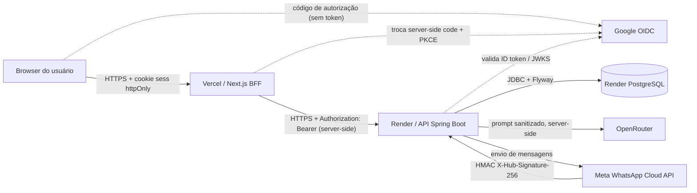
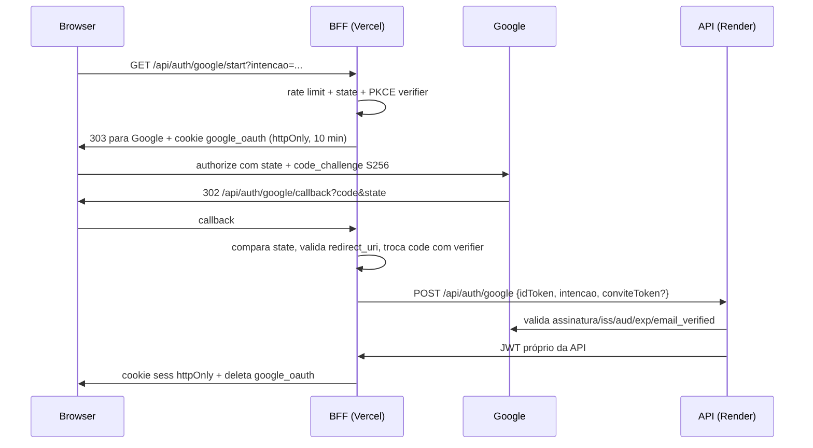
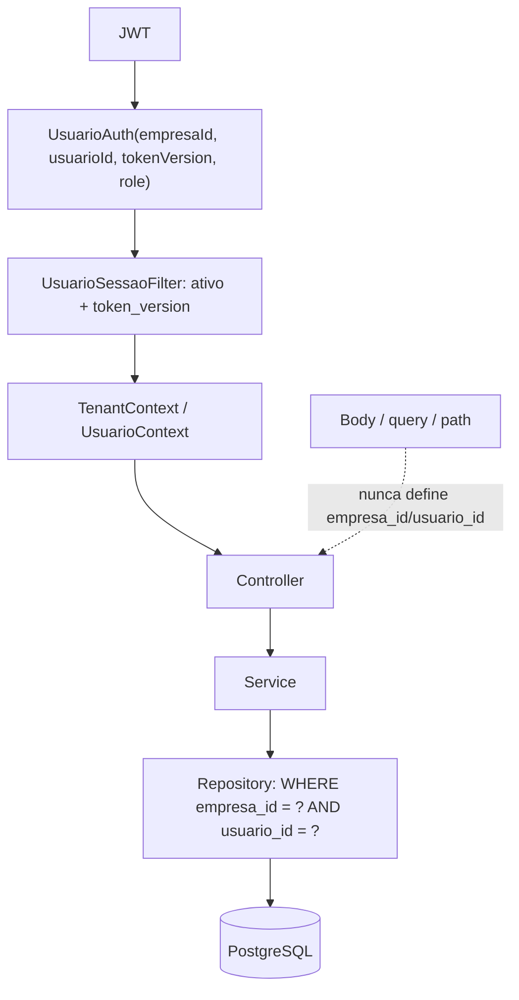
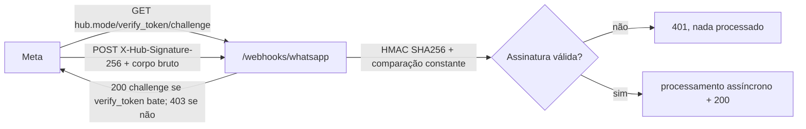

# SECURITY-ARCHITECTURE.md — Controle Financeiro

**Atualizado em:** 2026-11-26
**Escopo:** segurança ponta a ponta (browser → BFF → API → banco → integrações), com controles implementados, lacunas e responsabilidades de validação.
**Convenção:** referências no formato `caminho/arquivo:linha` apontam para o estado atual do working tree. Quando documentação antiga diverge do código, o código prevalece.
**Relação com outros documentos:** `ARCHITECTURE.md` descreve o sistema; `SECURITY.md` é o relatório de auditoria de 2026-11-21 (commit `8b726a9`) e permanece intacto como baseline. Este arquivo é a visão arquitetural atualizada.

---

## 1. Resumo executivo

A segurança do projeto apoia-se em seis ideias:

| # | Ideia | Onde está implementado |
|---|-------|------------------------|
| S1 | O browser nunca recebe JWT nem token do Google; ele só guarda cookie `sess` httpOnly no BFF | `web/lib/session.ts:3-12`, `web/lib/bff.ts:28-31` |
| S2 | O ID token Google é validado no servidor; a sessão da API é sempre o JWT próprio | `web/app/api/auth/google/callback/route.ts:83-100`, `api/src/main/java/com/controlefinanceiro/auth/GoogleTokenValidator.java:59-93`, `api/src/main/java/com/controlefinanceiro/auth/GoogleAuthService.java:46-50` |
| S3 | JWT HS256 de 8h com `empresa_id`, `usuario_id`, `token_version` e `role` | `api/src/main/java/com/controlefinanceiro/auth/JwtService.java:31-39,64-79` |
| S4 | `empresa_id` e `usuario_id` vêm somente do `SecurityContext`, nunca de body/query | `api/src/main/java/com/controlefinanceiro/common/TenantContext.java:7-26`, `api/src/main/java/com/controlefinanceiro/common/UsuarioContext.java:10-18` |
| S5 | Isolamento é por empresa **e** por usuário, inclusive para ADMIN | `MULT_TENANT.md:83-92`, `api/src/main/java/com/controlefinanceiro/lancamento/LancamentoRepository.java:19-60` |
| S6 | Integrações caras/públicas têm defesas específicas: HMAC, sanitização, limites e ADMIN-only | `api/src/main/java/com/controlefinanceiro/whatsapp/WhatsappWebhookController.java:79-127`, `api/src/main/java/com/controlefinanceiro/ai/rag/RagController.java:34-65`, `api/src/main/java/com/controlefinanceiro/importacao/ImportacaoService.java:61-71` |

**Status consolidado:**

| Área | Situação | Observação |
|------|----------|------------|
| Autenticação e JWT | Implementado | Validação framework, claims obrigatórias, revogação por `token_version` |
| Google/OIDC + PKCE | Implementado | `state`, `verifier`, `redirect_uri` em cookie httpOnly; ID token validado no backend |
| Autorização | Implementado | Matriz por rota em `api/src/main/java/com/controlefinanceiro/config/SecurityConfig.java:56-88` (ADMIN ≠ acesso financeiro alheio) |
| Isolamento de dados | Implementado | Repositórios filtram `empresa_id + usuario_id` |
| BFF/cookies/headers | Implementado | Cookie httpOnly, allowlist de rotas, CORS fechado, headers de segurança |
| Rate limiting | **Parcial** | Existe apenas no start/callback Google, em memória por instância |
| Webhook/HMAC | Implementado | HMAC SHA256 + comparação em tempo constante; anti-replay depende de validação externa |
| IA/RAG/OpenRouter | Implementado com ressalva | Chave fora do browser; memória e conhecimento escopados; dados financeiros vão para o provider |
| Upload de PDF | Implementado | Magic bytes, 8 MB, 10 arquivos, staging, sem PDF bruto persistido |
| Logs e erros | Implementado | Redação centralizada e ProblemDetail genérico |
| Segredos | Implementado no código | Env vars, `sync:false`, `.env*` ignorado; rotação é pendência do owner |
| LGPD | **Pendente fora do código** | Página `/privacidade`, consentimento persistido e DPAs ainda não existem no repo |
| Deploy/provider | **A validar pelo owner** | TLS, backup, retenção, WAF e limites de edge não são verificáveis por source |

> **Atenção ao working tree:** o código corrente contém trabalho não commitado em `api/src/main/java/com/controlefinanceiro/config/ProblemDetailExceptionHandler.java`, `api/src/main/java/com/controlefinanceiro/conta/`, `api/src/main/resources/db/migration/V13__conta_a_pagar_pagamento.sql`, `api/src/main/resources/db/migration/V14__consolida_self_service.sql`, `web/app/api/contas-a-pagar/[id]/route.ts`, `web/app/contas-a-pagar/page.tsx`, `web/components/ContasAPagarClient.tsx`, `web/components/ai/ChatFlutuante.tsx` e `web/e2e/user-helpdesk.spec.ts`. Este documento descreve o estado no disco; itens dependentes dessas mudanças estão marcados como **em andamento**.

---

## 2. Modelo de confiança



### 2.1 Fronteiras e o que cada uma confia

| Fronteira | Entrada | Validação de confiança | Falha típica evitada |
|-----------|---------|------------------------|----------------------|
| Browser → BFF | Cookie `sess`, código de autorização do OAuth, formulários | `httpOnly`, `SameSite=Lax`, `Secure` em produção; `state`/PKCE no OAuth | JWT exposto a JS, CSRF de navegação, login CSRF |
| BFF → API | `Authorization: Bearer <JWT>` | Não confia em cookie do browser; converte claims e revalida usuário | Bearer forjado, usuário desativado continuar logado |
| API → Banco | `empresa_id + usuario_id` do JWT | `TenantContext`/`UsuarioContext` + repositórios filtrados | IDOR entre empresas e entre usuários |
| Meta → API | Payload público do webhook | HMAC SHA256 com `WHATSAPP_APP_SECRET` | Webhook falso |
| API → OpenRouter/Meta | Texto e dados financeiros | Sanitização no PDF, chaves server-side, ADMIN para administração | Vazamento de chave, prompt poisoning entre tenants |
| Vercel preview → API | `API_URL` por ambiente | Fail-closed se não houver preview isolado | Preview apontando para produção |

O `proxy.ts` é **gate de UX**, não limite de autorização: ele só verifica presença do cookie (`web/proxy.ts:11-29`). A autorização real acontece no Spring Security e nos serviços.

---

## 3. Autenticação

### 3.1 Login por senha

1. O browser envia e-mail/senha ao BFF (`web/app/api/auth/login/route.ts:12-33`).
2. O BFF chama `POST /api/auth/login` e nunca devolve o JWT ao cliente; ele grava o cookie `sess` (`web/app/api/auth/login/route.ts:52-59`).
3. A API compara hash BCrypt(12) e usa a **mesma** exceção genérica para e-mail inexistente, usuário inativo e senha errada (`api/src/main/java/com/controlefinanceiro/auth/AuthService.java:28-37`, `api/src/main/java/com/controlefinanceiro/config/SecurityConfig.java:135-139`).
4. O BFF também normaliza qualquer 401 para “E-mail ou senha inválidos” (`web/app/api/auth/login/route.ts:39-42`).

**Controle anti-enumeração:** não há diferença de resposta entre “usuário não existe” e “senha errada”. Isso vale para cadastro (`CadastroInvalidoException` em `api/src/main/java/com/controlefinanceiro/config/ProblemDetailExceptionHandler.java:67-71`) e convite (`ConviteInvalidoException` em `:73-77`).

### 3.2 JWT próprio

| Propriedade | Valor | Evidência |
|-------------|-------|-----------|
| Algoritmo | HS256 fixo, Nimbus | `api/src/main/java/com/controlefinanceiro/auth/JwtService.java:57-60,78-79` |
| Segredo | `JWT_SECRET`, obrigatório, mínimo 32 bytes; fail-fast | `api/src/main/java/com/controlefinanceiro/auth/JwtService.java:41-54`, `api/src/main/resources/application.yml:49-53` |
| Validade | 8 horas, sem refresh | `api/src/main/java/com/controlefinanceiro/auth/JwtService.java:38-39,73-75` |
| Claims | `sub`=e-mail, `empresa_id`, `usuario_id`, `token_version`, `role` | `api/src/main/java/com/controlefinanceiro/auth/JwtService.java:64-75` |
| Decoder | Mesmo segredo; valida assinatura, `exp`, `iat` | `api/src/main/java/com/controlefinanceiro/auth/JwtService.java:57-60` |
| Conversão | Claims ausentes/inválidas → `InvalidBearerTokenException` | `api/src/main/java/com/controlefinanceiro/config/SecurityConfig.java:102-132` |
| Revogação | `UsuarioSessaoFilter` consulta `ativo` e `token_version` por request | `api/src/main/java/com/controlefinanceiro/config/UsuarioSessaoFilter.java:30-44` |

**Consequência importante:** logout apaga somente o cookie (`web/app/api/auth/logout/route.ts:4-7`); o JWT continua criptograficamente válido até expirar, a menos que `token_version` seja incrementado ou o usuário seja desativado. Desativar/demitir, portanto, tem efeito imediato, mas “sair” não é revogação global.

### 3.3 Google OIDC no BFF + API



Controles:

- `state` e `verifier` usam `crypto.getRandomValues` com 32 bytes; challenge é SHA-256 base64url (`web/lib/google-oauth.ts:23-59`).
- `redirect_uri` é derivado da própria request e validado no callback (`web/app/api/auth/google/callback/route.ts:45,47-53,85`).
- `code`, `state`, `verifier`, `intencao`, `conviteToken` e `redirectUri` ficam em `google_oauth`, httpOnly/`SameSite=Lax`/Secure em prod/10 min (`web/app/api/auth/google/start/route.ts:48-58`).
- O callback exclui `google_oauth` em qualquer falha (`web/lib/auth-bff.ts:28-31`) e em sucesso (`web/app/api/auth/google/callback/route.ts:143-146`).
- O client secret nunca vai ao browser; a troca de código usa `server-only` (`web/lib/google-oauth-server.ts:1-27`).
- O backend usa a biblioteca oficial do Google, com `iss=https://accounts.google.com`, `aud=GOOGLE_CLIENT_ID`, verificação de expiração e `email_verified=true` obrigatório (`api/src/main/java/com/controlefinanceiro/auth/GoogleTokenValidator.java:27-49,59-93`).
- Falha de JWKS/I/O vira `503`, não vira aceitação do token (`api/src/main/java/com/controlefinanceiro/auth/GoogleTokenValidator.java:69-72`, `api/src/main/java/com/controlefinanceiro/config/ProblemDetailExceptionHandler.java:61-65`).
- Um `google_sub` já vinculado a outra conta não pode ser reivindicado (`api/src/main/java/com/controlefinanceiro/auth/GoogleAuthService.java:93-100`).
- O botão Google só aparece/habilita quando `GOOGLE_CLIENT_ID` e `GOOGLE_CLIENT_SECRET` existem (`web/lib/google-oauth-config.ts`, `web/.env.example:6-11`).

### 3.4 Convites

`ConviteService` (`api/src/main/java/com/controlefinanceiro/usuario/ConviteService.java:49-129`):

| Controle | Implementação |
|----------|---------------|
| Token imprevisível | 32 bytes de `SecureRandom`, Base64URL sem padding (`:57-59`) |
| Persistência | Apenas SHA-256 do token (`token_hash`), nunca o claro (`:65,120-128`, `api/src/main/resources/db/migration/V9__multi_tenant_usuarios.sql:12-25`) |
| Validade | 7 dias (`:27,66`) |
| Single-use | `usado_em` verificado antes de aceitar (`:89,112`) |
| E-mail fixo | Convite só é aceito pelo e-mail para o qual foi emitido (`:92-94`, `api/src/main/java/com/controlefinanceiro/auth/GoogleAuthService.java:58-64`) |
| Senha | Quando não informada, UUID aleatório é hashed com BCrypt — login por senha é impossível (`:103-104`) |
| Role | Preservada do convite (`:105`) |

No web, o token do convite não trafega na query do start OAuth: `/convite/[token]` valida o formato, grava cookie `convite_oauth` httpOnly/10 min e redireciona (`web/app/convite/[token]/route.ts:4-17`, `web/lib/google-convite.ts:1-18`). O start lê esse cookie, copia para `google_oauth` e apaga o cookie de convite (`web/app/api/auth/google/start/route.ts:31-38,59`).

**Gap funcional de segurança/UX:** `web/proxy.ts:32-35` não isenta `/convite`; um visitante sem `sess` é redirecionado para `/login` antes de o route handler do convite rodar. Isso não expõe dados, mas quebra o fluxo para usuários não autenticados.

### 3.5 Cadastro e papéis

`TenantOnboardingService` cria empresa + primeiro usuário + categorias padrão em uma transação (`api/src/main/java/com/controlefinanceiro/usuario/TenantOnboardingService.java:38-46,65-91`). No estado atual do código o primeiro usuário é `USER` (`:81`), alinhado ao quick plan de correções pós-deploy (`.planning/quick/261125-correcoes-pos-deploy/261125-PLAN.md:6,13-16`); decisões antigas que diziam `ADMIN` estão desatualizadas.

E-mail é globalmente único; `google_sub` tem índice único parcial (`api/src/main/resources/db/migration/V9__multi_tenant_usuarios.sql:4-10`). Novos usuários Google recebem `senha_hash` BCrypt de UUID aleatório e `email_verificado=true` (`api/src/main/java/com/controlefinanceiro/usuario/TenantOnboardingService.java:48-63`).

---

## 4. Autorização

### 4.1 Matriz em `SecurityConfig`

| Rota | Regra | Evidência |
|------|-------|-----------|
| `/api/auth/login`, `/registro`, `/google`, `/convites/aceitar`, `/api/health` | público | `api/src/main/java/com/controlefinanceiro/config/SecurityConfig.java:58-64` |
| GET/POST `/webhooks/whatsapp` | público, protegido por verify token/HMAC | `api/src/main/java/com/controlefinanceiro/config/SecurityConfig.java:65-69` |
| `GET /api/categorias` | ADMIN ou USER | `api/src/main/java/com/controlefinanceiro/config/SecurityConfig.java:70-72` |
| Escrita em `/api/categorias/**` | ADMIN | `api/src/main/java/com/controlefinanceiro/config/SecurityConfig.java:73-74` |
| `/api/usuarios/**` | ADMIN | `api/src/main/java/com/controlefinanceiro/config/SecurityConfig.java:75-77` |
| `/api/ai/chat/conhecimento`, `/api/ai/chat/conhecimento/**` | ADMIN | `api/src/main/java/com/controlefinanceiro/config/SecurityConfig.java:78-80` |
| `/api/ai/rag/**` | ADMIN | `api/src/main/java/com/controlefinanceiro/config/SecurityConfig.java:81-82` |
| `/api/helpdesk/**` | USER | `api/src/main/java/com/controlefinanceiro/config/SecurityConfig.java:83-84` |
| `/api/admin/helpdesk/**` | ADMIN | `api/src/main/java/com/controlefinanceiro/config/SecurityConfig.java:85-86` |
| Demais rotas | autenticado | `api/src/main/java/com/controlefinanceiro/config/SecurityConfig.java:87-88` |

`role` é validado contra o enum `ADMIN|USER` na conversão do JWT (`api/src/main/java/com/controlefinanceiro/config/SecurityConfig.java:117-131`). A API não usa sessão HTTP: `SessionCreationPolicy.STATELESS` (`:55`), CSRF desligado por desenho (`:42-44`) e CORS desligado (`:44`). Isso é correto enquanto o navegador fala **somente** com o BFF e o BFF envia Bearer server-side. Se a API passar a aceitar cookie diretamente, CSRF/CORS precisam ser revisitados (`SECURITY.md:281`).

### 4.2 ADMIN não é administrador financeiro global

ADMIN gerencia contas da empresa (`api/src/main/java/com/controlefinanceiro/usuario/UsuarioService.java:94-113`), mas não lê lançamentos, importações, dashboard, IA-histórico ou WhatsApp de outros usuários. A matriz está em `MULT_TENANT.md:83-92`. Recursos fora do escopo do ADMIN retornam `404`/`403`, nunca dados de outro tenant/usuário.

---

## 5. Isolamento multi-tenant e por usuário



### 5.1 Regra

`empresa_id` e `usuario_id` são lidos exclusivamente do principal autenticado:

- `TenantContext.getEmpresaId()` só aceita `UsuarioAuth` autenticado; caso contrário lança `NaoAutorizadoException` (`api/src/main/java/com/controlefinanceiro/common/TenantContext.java:18-26`).
- `UsuarioContext.getUsuarioId()` segue o mesmo padrão (`api/src/main/java/com/controlefinanceiro/common/UsuarioContext.java:10-18`).
- DTOs de negócio não expõem/aceitam `empresa_id`; `fail-on-unknown-properties: true` rejeita campos extras (`api/src/main/resources/application.yml:28-36`).
- Exceções deliberadas de pré-auth derivam a empresa do estado criado/validado no servidor (`MULT_TENANT.md:59`).

### 5.2 Matriz por recurso

| Recurso | Escopo | Evidência representativa |
|---------|--------|--------------------------|
| Lançamentos | `empresa_id + usuario_id` | `api/src/main/java/com/controlefinanceiro/lancamento/LancamentoRepository.java:19-60`, `api/src/main/java/com/controlefinanceiro/lancamento/LancamentoService.java:73-117` |
| Importações | `empresa_id + usuario_id` | `api/src/main/java/com/controlefinanceiro/importacao/ImportacaoDocumentoRepository.java:16-25`, `api/src/main/java/com/controlefinanceiro/importacao/ImportacaoService.java:280-337` |
| Dashboard | `empresa_id + usuario_id` | `api/src/main/java/com/controlefinanceiro/ai/AiContextoService.java:116`, `api/src/main/java/com/controlefinanceiro/ai/tools/FerramentasFinanceiras.java:213` |
| Contas a pagar | `empresa_id + usuario_id` | `api/src/main/java/com/controlefinanceiro/conta/ContaAPagarRepository.java:17-33`, `api/src/main/java/com/controlefinanceiro/conta/ContaAPagarService.java:32-44` **(em andamento)** |
| Helpdesk do USER | `empresa_id + usuario_id` | `api/src/main/java/com/controlefinanceiro/helpdesk/HelpdeskTicketRepository.java:16-32` |
| IA memória | `empresa_id + usuario_id + sessionId` | `api/src/main/java/com/controlefinanceiro/ai/AiMemoryStore.java:38-40,46-76,99-112` |
| IA conhecimento | `empresa_id`, ADMIN | `api/src/main/java/com/controlefinanceiro/ai/AiKnowledgeStore.java:8-27`, `api/src/main/java/com/controlefinanceiro/config/SecurityConfig.java:78-80` |
| Categorias | `empresa_id`; escrita ADMIN | `api/src/main/java/com/controlefinanceiro/categoria/CategoriaRepository.java:31`, `api/src/main/java/com/controlefinanceiro/config/SecurityConfig.java:70-74` |
| Usuários | `empresa_id`, ADMIN, só contas | `api/src/main/java/com/controlefinanceiro/usuario/UsuarioRepository.java:22`, `api/src/main/java/com/controlefinanceiro/config/SecurityConfig.java:75-77` |
| WhatsApp | telefone → `empresa_id + usuario_id` | `MULT_TENANT.md:91` |

Erros de acesso a recurso de outro tenant/usuário são `404` (`api/src/main/java/com/controlefinanceiro/config/ProblemDetailExceptionHandler.java:80-99`), evitando confirmar existência.

---

## 6. BFF, cookies e proteção do browser

### 6.1 Cookie `sess`

| Atributo | Valor | Evidência |
|----------|-------|-----------|
| `httpOnly` | `true` | `web/lib/session.ts:6` |
| `sameSite` | `lax` | `web/lib/session.ts:7` |
| `path` | `/` | `web/lib/session.ts:8` |
| `secure` | `NODE_ENV === "production"` | `web/lib/session.ts:9` |
| `maxAge` | 8 horas | `web/lib/session.ts:10` |
| `domain` | não definido (same-origin da Vercel) | `web/lib/session.ts:5-11` |

Nenhum token é gravado em `localStorage`/`sessionStorage`. O JWT chega ao servidor via `Authorization: Bearer` apenas dentro de route handlers/server components (`web/lib/bff.ts:28,48-61`, `web/lib/api.ts`).

### 6.2 Allowlist e fail-closed

`encaminharParaApi()`:

1. Valida o caminho contra `urlApiSegura()` — só caminhos `/api/...` conhecidos, sem `..` ou `//` (`web/lib/bff-helpers.ts:3-26`; uso em `web/lib/bff.ts:18-21`).
2. Exige `sess`; sem cookie responde `401` (`web/lib/bff.ts:28-31`).
3. Usa `urlApiServidor()`; em preview, exige `API_URL_PREVIEW`, exige `API_URL_PRODUCAO` e rejeita origens iguais/inválidas (`web/lib/api-url.ts:10-24`).
4. Define `cache: "no-store"` e timeout de 5 s (`web/lib/bff.ts:55-61`, `web/lib/bff-helpers.ts:1`).
5. Mapeia erro de rede para `502`, timeout para `504` (`web/lib/bff.ts:80-85`).

Isso fecha o achado F-003 da auditoria antiga: não há mais fallback para `NEXT_PUBLIC_API_URL`, nem cookies `access_token`/`auth_token`. As rotas atuais de contas-a-pagar usam apenas `encaminharParaApi()` (`web/app/api/contas-a-pagar/route.ts:4-8`, `web/app/api/contas-a-pagar/[id]/route.ts:6-16`).

### 6.3 Headers e CSRF

Web (`web/next.config.ts:3-19`) e API (`api/src/main/java/com/controlefinanceiro/config/SecurityConfig.java:45-54`) enviam:

| Header | Valor |
|--------|-------|
| `X-Content-Type-Options` | `nosniff` |
| `X-Frame-Options` | `DENY` |
| `Referrer-Policy` | `strict-origin-when-cross-origin` |
| `Permissions-Policy` | `camera=(), microphone=(), geolocation=()` |
| `Strict-Transport-Security` | `max-age=63072000; includeSubDomains; preload` (web) / `max-age=63072000; includeSubDomains` (API) |

`cache-control: no-store` é aplicado nas respostas do BFF (`web/lib/bff.ts:67-70`). Não há CSP configurada no código — se for adotada, precisa ser testada contra os assets do Next.

---

## 7. Integrações

### 7.1 Webhook do WhatsApp



- Sem `WHATSAPP_APP_SECRET` ou sem `WHATSAPP_VERIFY_TOKEN`, o webhook responde `503` em vez de aceitar requisição não validada (`api/src/main/java/com/controlefinanceiro/whatsapp/WhatsappWebhookController.java:61-68,84-87`, `api/src/main/resources/application.yml:95-103`).
- O HMAC cobre o corpo bruto e a comparação é caractere a caractere, em tempo constante (`api/src/main/java/com/controlefinanceiro/whatsapp/WhatsappWebhookController.java:102-127`).
- Logs de erro do processamento passam por `LogRedacao.mensagem(e)` (`api/src/main/java/com/controlefinanceiro/whatsapp/WhatsappWebhookService.java:114`).

**A validar pelo owner:** janela anti-replay, idempotência efetiva, rate limit do endpoint e retenção/acesso aos logs na Render (`SECURITY.md:165-185,253-273`).

### 7.2 IA, OpenRouter e RAG

| Controle | Implementação |
|----------|---------------|
| Chave da IA | `OPENROUTER_API_KEY` apenas na API (`api/src/main/resources/application.yml:62-70`, `render.yaml:49-50`); nenhuma referência a OpenRouter no bundle do browser |
| Sessões | Chave `empresaId::usuarioId::sessionId`; consultas persistentes usam `findByEmpresaIdAndUsuarioIdAndSessionId` (`api/src/main/java/com/controlefinanceiro/ai/AiMemoryStore.java:38-40,50-76,103-112,139-150`) |
| Conhecimento | Store por `empresaId`; endpoints ADMIN-only (`api/src/main/java/com/controlefinanceiro/ai/AiKnowledgeStore.java:17-27`, `api/src/main/java/com/controlefinanceiro/config/SecurityConfig.java:78-80`, `api/src/main/java/com/controlefinanceiro/ai/AiController.java:56-71`) |
| RAG | Ingestão/status em `/api/ai/rag/**`, ADMIN-only (`api/src/main/java/com/controlefinanceiro/ai/rag/RagController.java:34-65`, `api/src/main/java/com/controlefinanceiro/config/SecurityConfig.java:81-82`); corpus estático no container (`render.yaml:51-52`) |
| Números | IA nunca grava sozinha e consulta repositórios/dashboard; core value em `AGENTS.md` e `ARCHITECTURE.md` R7 |
| Erro amigável | `ServicoIaIndisponivelException` → `503` (`api/src/main/java/com/controlefinanceiro/config/ProblemDetailExceptionHandler.java:192-199`) |

**Ressalva LGPD/privacidade:** prompts do chat podem conter dados financeiros reais; o texto extraído de PDF é sanitizado antes do envio (`api/src/main/java/com/controlefinanceiro/importacao/ImportacaoService.java:708`; máscaras em `api/src/main/java/com/controlefinanceiro/importacao/SanitizadorTexto.java:7-11,32-37`), mas a política de consentimento/DPA com OpenRouter ainda é pendência externa.

### 7.3 Upload de PDF

| Defesa | Valor/limite | Evidência |
|--------|--------------|-----------|
| Content-Type + magic bytes | `application/pdf` e `%PDF` | `api/src/main/java/com/controlefinanceiro/importacao/ImportacaoService.java:61-65` |
| Tamanho por arquivo | 8 MB | `api/src/main/java/com/controlefinanceiro/importacao/ImportacaoService.java:67-68`, `api/src/main/resources/application.yml:38-42` |
| Lote | até 10 arquivos | `api/src/main/java/com/controlefinanceiro/importacao/ImportacaoService.java:70-71,160-168` |
| Páginas/caracteres | 200 / 200.000 | `api/src/main/resources/application.yml:44-47` |
| Duplicidade | hash SHA-256 por empresa/usuário | `api/src/main/java/com/controlefinanceiro/importacao/ImportacaoService.java:674`, `api/src/main/java/com/controlefinanceiro/importacao/ImportacaoDocumentoRepository.java:16` |
| Persistência | PDF bruto e texto bruto **não** são persistidos | `.planning/phases/05-importa-o-de-pdfs-e-an-lise-por-ia/05-CONTEXT.md:22,48`, `api/src/main/java/com/controlefinanceiro/importacao/PdfTextoExtractor.java:15`, `api/src/main/java/com/controlefinanceiro/importacao/model/ImportacaoDocumento.java:21` |
| Gravação | Só após confirmação explícita, em transação | `api/src/main/java/com/controlefinanceiro/importacao/ImportacaoController.java:76-89`, `api/src/main/java/com/controlefinanceiro/importacao/ImportacaoService.java:236-239` |
| Logs | Nome de arquivo e exceções redacionados | `api/src/main/java/com/controlefinanceiro/importacao/ImportacaoService.java:196-232,863-867` |

Não há antivirus ou sandbox dedicated para PDFBox; isso é uma decisão de risco aceita, não uma prova de ausência de parser DoS.

---

## 8. Dados sensíveis, logs e LGPD

### 8.1 Redação

`LogRedacao.paraLog()` (`api/src/main/java/com/controlefinanceiro/common/LogRedacao.java:22-32`) aplica, em ordem:

1. `Bearer ...` → `[REDACTED]` (`:11,26`)
2. `conviteToken=...` → `[REDACTED]` (`:12-13,27`)
3. e-mail → `[REDACTED]` (`:14-15,28`)
4. telefone E.164 → `[REDACTED]` (`:16,29`)
5. JWT `eyJ...` → `[REDACTED]` (`:17-18,30`)
6. CPF/CNPJ/cartão via `SanitizadorTexto` (`:31`; `api/src/main/java/com/controlefinanceiro/importacao/SanitizadorTexto.java:19-37,55-75`)
7. truncamento em 200 caracteres (`api/src/main/java/com/controlefinanceiro/common/LogRedacao.java:9,41-51`)

Uso confirmado em `api/src/main/java/com/controlefinanceiro/importacao/IaExtracaoService.java:157`, `api/src/main/java/com/controlefinanceiro/importacao/ImportacaoService.java:199,216,221,865` e `api/src/main/java/com/controlefinanceiro/whatsapp/WhatsappWebhookService.java:114`. O handler de erros RFC 7807 registra em javadoc que nunca deve logar `Authorization`, cookie ou body de login (`api/src/main/java/com/controlefinanceiro/config/ProblemDetailExceptionHandler.java:42-45`).

### 8.2 Dados tratados

| Categoria | Exemplos | Destino/interprocador |
|-----------|----------|-----------------------|
| Conta | e-mail, nome, hash BCrypt, `google_sub`, `token_version` | Google (OIDC), Render (DB) |
| Financeiro | lançamentos, categorias, dashboard, contas a pagar | PostgreSQL, prompts de IA |
| Documental | nome do PDF, hash SHA-256, metadados, itens extraídos | OpenRouter (texto sanitizado), PostgreSQL |
| Comunicação | telefone, código de verificação, mensagens WhatsApp | Meta Cloud API, PostgreSQL |
| Suporte | tickets e mensagens de helpdesk | PostgreSQL |

### 8.3 Pré-requisitos LGPD x pendência real

O app já entrega: isolamento por empresa/usuário, BCrypt, HTTPS assumido no deploy, mínimo de dados no PDF, redação de logs e erro genérico. Porém:

- Não existe `web/app/privacidade/page.tsx` no repositório.
- Não há flag de consentimento persistida por usuário em `api/src/main/resources/db/migration/V9__multi_tenant_usuarios.sql` (há apenas `email_verificado`).
- Não há DPA/retensão documentada com Google, OpenRouter e Meta no repo.
- A task 06-07 previa esses itens (`.planning/phases/06-multi-tenant/06-07-PLAN.md:72,79,87`), mas o texto jurídico é externo ao fluxo GSD (`.planning/PROJECT.md:39`, `.planning/REQUIREMENTS.md:96`).

**Interpretação:** a arquitetura está preparada para LGPD; o **uso real em produção com dados de terceiros depende** de página pública, consentimento e contratos. Isso é pendência do owner/jurídico, não falha de criptografia.

---

## 9. Segredos e configuração

| Variável | Onde vive | Browser vê? | Observação |
|----------|-----------|-------------|------------|
| `JWT_SECRET` | Render, `sync:false` | Não | Mínimo 32 bytes; rotação pendente |
| `SEED_ADMIN_PASSWORD` | Render, `sync:false` | Não | Rotacionar após primeiro login |
| `SPRING_DATASOURCE_URL/USERNAME/PASSWORD` | Render, `sync:false` | Não | JDBC com prefixo `jdbc:` (`render.yaml:3-6`) |
| `GOOGLE_CLIENT_ID` | Vercel + Render | Sim, é público | Necessário no authorize e no validador |
| `GOOGLE_CLIENT_SECRET` | Vercel, server-side | Não | `web/lib/google-oauth-server.ts:6-8` |
| `OPENROUTER_API_KEY` | Render | Não | Somente API |
| `WHATSAPP_APP_SECRET`, `WHATSAPP_ACCESS_TOKEN`, `WHATSAPP_VERIFY_TOKEN` | Render | Não | Webhook e envio |
| `API_URL`, `API_URL_PREVIEW`, `API_URL_PRODUCAO` | Vercel, server-side | Não | `web/.env.example:1-4`; guard em `api-url.ts` |
| `NEXT_PUBLIC_GOOGLE_CLIENT_ID`, `NEXT_PUBLIC_GOOGLE_OAUTH_ENABLED` | Vercel | Sim, publícas por design | Não são segredos (`web/.env.example:6-11`) |

`.gitignore:4-22` bloqueia `.env*`, `login.json`, `token-response.json`, scripts de teste com JWT/senha e logs. `render.yaml:18-19` usa `sync:false` para valores sensíveis. Nenhum valor de segredo é exibido neste documento.

---

## 10. Deploy, ambientes e CI

### 10.1 Render / Vercel

| Controle | Estado | Evidência/owner |
|----------|--------|-----------------|
| API em Docker, healthcheck `/api/health` | Código | `render.yaml:26-35` |
| Postgres com backup e plano pago | **Pendente** | `render.yaml:12-16` registra desvio; `.planning/STATE.md:81-83` |
| Staging separado | **Inexistente (D-08)** | `render.yaml:12-16` |
| Preview isolado | Código fail-closed; config pendente | `web/lib/api-url.ts:13-20`; owner deve definir `API_URL_PREVIEW`/`API_URL_PRODUCAO` |
| `GOOGLE_* sync:false` | Código | `render.yaml:47-48` |
| TLS/HSTS/redirect HTTP→HTTPS | A validar no provider | `SECURITY.md:209-231` |
| WAF/rate limit de edge | A validar no provider | `SECURITY.md:165-185` |

### 10.2 CI

`.github/workflows/ci.yml` roda em PR/push em `main`, com `permissions: contents: read` (`:8-9`) e **nenhum segredo de deploy**:

| Job | Comandos |
|-----|----------|
| API (Java 21) | `./mvnw -B -Dspotless.check.skip=true test`, `./mvnw -B spotless:check` (`:12-28`) |
| Web (Node 22) | `npm ci`, `npm run lint`, `npx tsc --noEmit`, Playwright unit specs, `npm run build` (`:30-56`) |
| Web env de CI | placeholders públicos e `NEXT_PUBLIC_GOOGLE_OAUTH_ENABLED=0` (`:36-40`) |

O build da API no Render executa `mvn clean verify` antes de empacotar (`api/Dockerfile`). Testes Docker-backed (Testcontainers/Postgres 16) exigem Docker ativo e não rodam nesse CI (`AGENTS.md`).

---

## 11. Status da auditoria `SECURITY.md`

| ID | Achado original | Estado atual | Evidência |
|----|-----------------|--------------|-----------|
| F-001 (Alto) | Sessão de IA envenenada entre tenants por `sessionId` | **Corrigido** | `api/src/main/java/com/controlefinanceiro/ai/AiMemoryStore.java:38-40,50-76`, `api/src/main/java/com/controlefinanceiro/ai/AiController.java:39-48,73-76`, `AiTenantIsolationTest.java` |
| F-002 (Alto) | Base de conhecimento da IA global | **Corrigido** | `api/src/main/java/com/controlefinanceiro/ai/AiKnowledgeStore.java:8-27`, `api/src/main/java/com/controlefinanceiro/config/SecurityConfig.java:78-80`, `api/src/main/java/com/controlefinanceiro/ai/AiController.java:56-71` |
| F-003 (Médio) | BFF de contas-a-pagar com fallbacks inseguros | **Corrigido no BFF**; controller backend em andamento | `web/lib/bff.ts`, `web/lib/bff-helpers.ts`, `web/app/api/contas-a-pagar/**`, `api/src/main/java/com/controlefinanceiro/conta/ContaAPagarController.java` |
| N-001 | Sem rate limit | **Parcial** | Start/callback Google limitados (`web/app/api/auth/google/start/route.ts:14-26`, `web/app/api/auth/google/callback/route.ts:10-12,64-73`); login/registro/IA/upload/webhook sem throttle no código |
| N-002 | Sem headers/CORS | **Corrigido no código** | `web/next.config.ts:3-19`, `api/src/main/java/com/controlefinanceiro/config/SecurityConfig.java:41-55`; HSTS real no edge a validar |
| N-003 | TLS/backup/retensão/secret storage | **A validar** | Código usa env vars, mas provider não é observável por source |
| N-004 | Preview apontando produção | **Código fail-closed; config pendente** | `web/lib/api-url.ts:10-24` vs. `render.yaml:12-16` |
| N-005 | Logs e retenção de conteúdo sensível | **Mitigado no código; retenção a validar** | `api/src/main/java/com/controlefinanceiro/common/LogRedacao.java:11-31`, `api/src/main/java/com/controlefinanceiro/importacao/SanitizadorTexto.java:19-37`, owner deve revisar logs/providers |

---

## 12. Modelo de ameaças

| Ameaça | Severidade | Defesa atual | Pendência |
|--------|-----------|--------------|-----------|
| JWT roubado por XSS | Alta | Cookie httpOnly, sem token no browser | CSP não configurada |
| Usuário desativado continuar logado | Alta | `UsuarioSessaoFilter` por request | Nenhuma |
| Cross-tenant/cross-user IDOR | Alta | Contexto do JWT + repositórios filtrados | Manter grep-gate/ArchUnit em novas queries |
| Role tampering no JWT | Alta | HS256 + validação `Role.from` | Rotação de `JWT_SECRET` pendente |
| Força bruta em login/registro/callback | Alta | Rate limit só em Google start/callback | Throttle em login/registro/API; provider WAF |
| Preview acessar produção | Alta | `urlApiServidor()` fail-closed | Definir variáveis de preview isoladas e proteger preview |
| ID token Google falso/não verificado | Alta | Biblioteca oficial, `iss`/`aud`/`exp`/`email_verified` | Nenhuma |
| Webhook falso/replay | Alta | HMAC com comparação constante | Anti-replay e limites no provider |
| Prompt poisoning entre tenants | Alta | Memória e conhecimento escopados; ADMIN-only | Validar retenção/OpenRouter e consentimento |
| Chave de IA/WhatsApp vazada | Alta | Env vars server-side, `.env*` ignorado, `sync:false` | Rotação e varredura de histórico do git |
| Upload malicioso/DoS | Média | Magic bytes, tamanho, lote, sem persistência do PDF | Antivírus/limites de parser não configurados |
| Enumeração de e-mail | Média | Erros genéricos em login/cadastro/convite | Nenhuma |
| CSRF no BFF | Média | `SameSite=Lax`, cookie same-origin, API sem cookie | Reavaliar se API passar a usar cookie |
| PII em logs | Média | `LogRedacao` central | Validar retenção/access no provider |

---

## 13. Checklist de verificação

Comandos do `AGENTS.md`, executados a partir de `api/` e `web/`:

```powershell
# api/
.\mvnw.cmd "-Dspotless.check.skip=true" test
.\mvnw.cmd -q spotless:check

# web/
npm run lint
npx tsc --noEmit
npx playwright test e2e/frontend-fixes.spec.ts e2e/google-oauth.spec.ts e2e/auth-bff.spec.ts
```

Testes adicionais úteis para segurança:

```powershell
# api/ — exige Docker ativo
.\mvnw.cmd test "-Dsurefire.excludes="

# web/ — specs unitárias, sem servidor
npx playwright test e2e/rag-admin.spec.ts e2e/user-helpdesk.spec.ts e2e/auth.spec.ts
```

Evidências de teste já registradas: `AiTenantIsolationTest.java`, `AuthTenantIntegrationTest.java`, `SessaoContextoIntegrationTest.java`, `AuthPublicoIntegrationTest.java`, `GoogleTokenValidatorTest.java`, `JwtServiceTest.java`, `SecurityHeadersTest.java`, `LogRedacaoTest.java`, `web/e2e/auth-bff.spec.ts`, `web/e2e/google-oauth.spec.ts`, `web/e2e/rag-admin.spec.ts`.

---

## 14. Pendências do owner

1. Rotacionar `JWT_SECRET`, senha do banco e `SEED_ADMIN_PASSWORD` — valores foram expostos em conversa (`.planning/STATE.md:81-83`).
2. Migrar Render Postgres para plano pago com backup e criar staging (`render.yaml:12-16`, `.planning/phases/06-multi-tenant/06-07-PLAN.md:21`).
3. Definir `API_URL_PREVIEW` e `API_URL_PRODUCAO` na Vercel, com origens diferentes, e proteger previews (`web/lib/api-url.ts:13-20`).
4. Confirmar HTTPS/HSTS, WAF e rate limits no edge (`SECURITY.md:165-207`).
5. Confirmar criptografia em repouso, backup criptografado e retenção de logs no Render (`SECURITY.md:209-231`).
6. Revisar DPA/retensão/treinamento de Google, OpenRouter e Meta; publicar `/privacidade` e registrar consentimento (`.planning/phases/06-multi-tenant/06-07-PLAN.md:72,79,87`).
7. Corrigir o gate de `/convite` em `web/proxy.ts:32-35` para não redirecionar visitante sem `sess` antes do route handler do convite.
8. Adicionar throttle em login/registro/API e, se possível, mover o rate limit de `Map` local para store compartilhado (`web/lib/rate-limit.ts:5-18`).
9. Rodar varredura de segredos no histórico do git (gitleaks/trufflehog) e revisar logs de produção com dados de teste.
